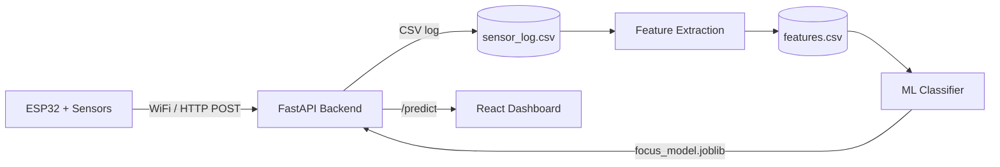

# FocusPulse

**Environmental & Behavioral Cognitive Load Monitor**

FocusPulse is an ESP32-based IoT system that infers whether you're focused or distracted by combining four signals — ambient noise, light stability, physical motion, and air quality (CO2 proxy) — and feeding them into a machine learning classifier. A live dashboard shows your current focus state in real time.

This is a semester project for a 3rd-year IoT course (Génie Logiciel / GLSI), built and simulated with [Wokwi](https://wokwi.com) before any physical hardware is required.

---

## How it works



1. **ESP32 firmware** reads four sensors every few seconds and sends a JSON payload over WiFi
2. **FastAPI backend** receives and logs readings, and serves live predictions
3. **Feature extraction** turns raw readings into windowed features (motion variance, jerk, CO2 drift, light stability, noise level)
4. **A trained classifier** (scikit-learn) predicts `focused` vs `distracted` from those features
5. **A live dashboard** polls the backend and displays the current state with a breathing pulse indicator

---

## Sensors

| Signal | Sensor | Notes |
|---|---|---|
| Motion / fidgeting | MPU6050 (accelerometer + gyroscope) | Native Wokwi part, I2C |
| Light | LDR breakout module | AO → analog pin |
| Air quality (CO2 proxy) | MQ2 gas sensor | Stand-in for MQ135 — Wokwi has no MQ135 part |
| Ambient noise | Sound sensor module | AO → analog pin |

---

## Tech stack

- **Firmware:** ESP32 (Arduino framework), WiFi, HTTPClient, ArduinoJson
- **Simulation:** Wokwi (web + PlatformIO/VS Code extension)
- **Backend:** FastAPI, pandas, numpy
- **ML:** scikit-learn (RandomForestClassifier)
- **Dashboard:** React (via CDN, no build step), Chart.js

---

## Project structure

```
FocusPulse/
├── firmware/
│   └── focuspulse_esp32.ino       # ESP32 firmware
├── backend/
│   ├── main.py                    # FastAPI app — /ingest, /latest, /predict
│   ├── label_logger.py            # Manual focus/distraction labeling tool
│   ├── feature_extraction.py      # Raw sensor data → windowed ML features
│   ├── train_model.py             # Trains and saves the classifier
│   ├── generate_synthetic_data.py # Bootstraps training data (see note below)
│   └── requirements.txt
├── dashboard.html                 # Live React dashboard (single file)
├── diagram.json                   # Wokwi circuit diagram
├── wokwi.toml                     # Wokwi simulation config
└── platformio.ini                 # PlatformIO build config
```

---

## Running it

### 1. Firmware + simulation
Open this project in [Wokwi for VS Code](https://docs.wokwi.com/vscode/getting-started) (or wokwi.com), build with PlatformIO, and run the simulation.

### 2. Backend
```bash
cd backend
pip install -r requirements.txt
uvicorn main:app --host 0.0.0.0 --port 8000 --reload
```

### 3. Collect labeled data (optional — see note below)
```bash
python label_logger.py
```
Hold each label (`f` / `d`) for several minutes at a time during real work sessions for clean, usable windows.

### 4. Extract features and train
```bash
python feature_extraction.py
python train_model.py
```

### 5. View the dashboard
Open `dashboard.html` in a browser. It polls the backend every 5 seconds and shows the live predicted state.

---

## On the training data

Collecting enough real labeled focus/distraction sessions in simulation is slow. To bootstrap the model, `generate_synthetic_data.py` generates configurable synthetic feature rows calibrated against self-reported focus patterns (e.g., motion increases with genuine focus and decreases when distracted, for this user — the opposite of the generic "fidgeting = distracted" assumption; air quality/CO2 drift is a strong, confirmed signal; ambient noise is a weak one).

```bash
python generate_synthetic_data.py --n 100 --noise 2.0
python train_model.py
```

This is a legitimate way to validate the pipeline and the underlying hypothesis end-to-end, but it is **not a substitute for real-world validation** — results reflect the calibrated assumptions, not ground-truth behavior. Real labeled sessions can be mixed in with `--append`, and should replace synthetic data entirely where possible for any claims beyond "the pipeline works."

---

## Status

- [x] Hardware wiring + firmware + WiFi ingestion
- [x] Feature extraction pipeline
- [x] Model training (synthetic-data baseline: ~82% accuracy)
- [x] Live `/predict` endpoint
- [x] Dashboard
- [ ] Real-session data collection
- [ ] Report + final validation

---

## License

Academic project — no license specified.
